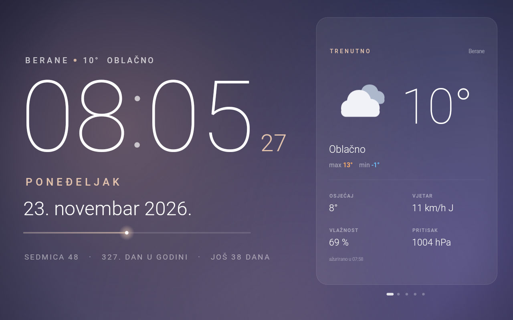

# Vrijeme — sat za policu

Android aplikacija koja stari tablet pretvara u lijep sat na polici: veliki sat, datum, prognoza
i kartice koje se same smjenjuju. Sav tekst je na crnogorskom.



## Šta prikazuje

- **Veliki sat** sa sekundama, dan i datum, sedmica i dan u godini
- **Kartice koje se smjenjuju na 12 s:**
  1. Trenutno vrijeme (temperatura, osjećaj, vjetar, vlažnost, pritisak)
  2. Narednih 12 sati (krivulja temperature, padavine)
  3. Narednih 5 dana
  4. Sunce i Mjesec (izlazak/zalazak, dužina dana, mijena)
  5. Kalendar mjeseca sa praznicima u Crnoj Gori
- Pozadina mijenja boje po dobu dana (zora, dan, zalazak, noć sa zvijezdama)
- Sadržaj se polako pomjera da se ekran ne „ureže"; noću (23–6 h) se ekran zatamni

## Upotreba

- Pokreće se sama kad se tablet upali (može se isključiti u podešavanjima)
- **Dodir** — sljedeća kartica
- **Dugi pritisak** — podešavanja: grad, položaj ekrana, noćno zatamnjenje, sekunde, pokretanje pri paljenju

Prognoza: [Open-Meteo](https://open-meteo.com) (bez ključa), osvježava se na 15 min i čuva se za rad bez interneta.

## Build

Native Kotlin, bez AndroidX zavisnosti, minSdk 21 (testirano na Androidu 6).

```
gradlew assembleRelease
```

Potrebna je `local.properties` sa `sdk.dir=...`.
